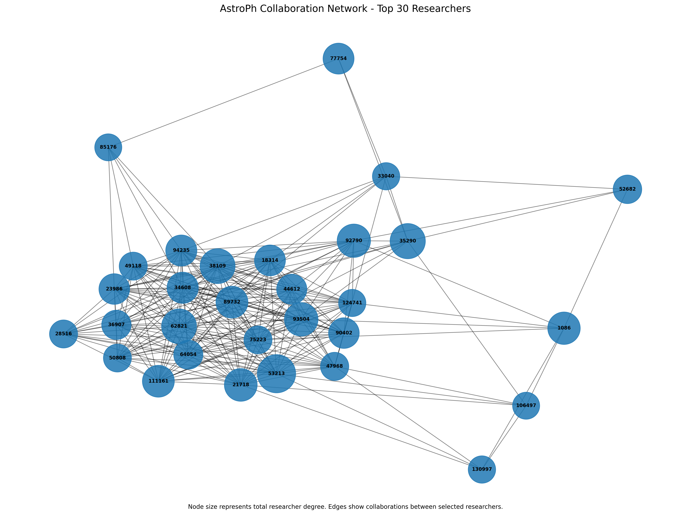

# 🌌 Astronomy Collaboration Network Analysis (ca-AstroPh)

### Academic Project (INT315: Big Data & Graph Analytics)

[](https://www.python.org/)
[](https://spark.apache.org/)
[](https://graphframes.github.io/graphframes/)
[](https://networkx.org/)

---

## 📌 Project Overview

This repository contains the implementation of **Project 63: Astronomy Collaboration Network Analysis**, developed as an academic coursework project for **INT315 (Big Data & Graph Analytics)**.

The project analyzes the **ArXiv AstroPhysics (ca-AstroPh)** co-authorship collaboration network obtained from the Stanford Network Analysis Platform (SNAP).

Using **Apache Spark, PySpark, and GraphFrames**, the project processes graph data, calculates degree centrality, identifies highly connected researchers, analyzes connected components, computes PageRank scores, and visualizes important collaboration hubs.

The analysis focuses on understanding the structure of the scientific collaboration network and comparing researchers based on their direct connections and PageRank scores.

---

## 📊 Dataset Description

The dataset represents scientific collaborations among researchers in the ArXiv Astrophysics category.

- **Source:** [Stanford SNAP ca-AstroPh Dataset](https://snap.stanford.edu/data/ca-AstroPh.html)
- **Total Researchers (Vertices):** 18,772
- **Valid Raw Edge Records:** 396,160
- **Self-loops Removed:** 60
- **Unique Undirected Edges:** 198,050
- **Graph Type:** Undirected and unweighted collaboration network

### Data Preprocessing

The original edge list was processed using PySpark DataFrames.

The preprocessing steps included:
- Filtering comment lines and invalid records.
- Removing self-loops.
- Normalizing edge endpoints using `least()` and `greatest()`.
- Removing duplicate undirected edges.
- Preserving all 18,772 researchers in the graph.

The final graph contains **18,772 vertices and 198,050 unique undirected edges**.

---

## 🛠️ Tech Stack & Prerequisites

- **Programming Language:** Python 3.10+
- **Big Data Processing:** Apache Spark / PySpark 4.x
- **Graph Processing:** GraphFrames 0.12.3
- **GraphFrames Package:** `io.graphframes:graphframes-spark4_2.13:0.12.3`
- **Network Analysis & Visualization:** NetworkX, Matplotlib
- **Java Runtime:** OpenJDK 17 (Eclipse Adoptium)

---

## 📂 Project Architecture & Pipeline

The project is organized into modular Python scripts inside the `code/` directory.

```text
INT315_Astr/
│
├── code/
│   ├── 01_data_loading.py
│   ├── 02_graph_construction.py
│   ├── 03_degree_centrality.py
│   ├── 04_top_researchers.py
│   ├── 05_graphframes_test.py
│   ├── 06_connected_components.py
│   ├── 07_pagerank.py
│   └── 08_network_visualization.py
│
├── dataset/
│   ├── ca-AstroPh_edges.txt
│   └── ca-AstroPh.txt.gz
│
├── outputs/
│   └── AstroPh_Top30_Network.png
│
├── .gitignore
├── requirements.txt
└── README.md
```

### Script Descriptions

| Script | Description |
|---|---|
| `01_data_loading.py` | Spark setup, raw data loading, cleaning, and edge normalization |
| `02_graph_construction.py` | Undirected graph construction and schema verification |
| `03_degree_centrality.py` | Degree calculation and normalized degree centrality |
| `04_top_researchers.py` | Identification of the most connected researchers |
| `05_graphframes_test.py` | GraphFrames package and environment validation |
| `06_connected_components.py` | Connected components analysis |
| `07_pagerank.py` | PageRank computation and researcher ranking |
| `08_network_visualization.py` | Top-30 subgraph extraction and NetworkX visualization |

---

## 🔬 Key Tasks & Methodologies

### 1. Data Cleaning and Undirected Graph Construction

Implemented in `01_data_loading.py` and `02_graph_construction.py`.

- Loaded raw tab-delimited co-authorship records using Spark DataFrames.
- Filtered comments and invalid records.
- Removed self-loops.
- Used `least()` and `greatest()` to normalize edge endpoints.
- Removed duplicate edges to construct an undirected graph.
- Preserved all 18,772 researchers as vertices.

**Final graph statistics:**
- Vertices: 18,772
- Unique undirected edges: 198,050

### 2. Degree Centrality and Top Collaborators

Implemented in `03_degree_centrality.py` and `04_top_researchers.py`.

Degree centrality measures the number of direct collaborators connected to each researcher.

Normalized degree centrality was calculated using:

`Degree Centrality(v) = Degree(v) / (N - 1)`

Where:
- `Degree(v)` represents the number of direct connections.
- `N` represents the total number of researchers (18,772).

**Top researcher by degree:**

| Researcher ID | Degree |
|---|---:|
| 53213 | 504 |
| 35290 | 427 |
| 38109 | 420 |
| 62821 | 418 |
| 93504 | 387 |

Researcher ID **53213** has the highest number of direct collaborations, with 504 connections.

### 3. Connected Components Analysis

Implemented in `06_connected_components.py`.

- Used the GraphFrames connected components algorithm.
- Identified separate connected groups in the collaboration network.
- Analyzed the size of the largest connected component.
- Examined the distribution of researchers across disconnected components.

**Results:**

| Metric | Result |
|---|---:|
| Total Connected Components | 290 |
| Largest Connected Component | 17,903 researchers |
| Remaining Components | 289 |
| Single-Researcher Components | 1 |

The largest connected component contains 17,903 out of 18,772 researchers, showing that the vast majority of researchers belong to one connected group.

### 4. PageRank Analysis

Implemented in `07_pagerank.py`.

PageRank was used to measure the structural importance of researchers based on the connections of their collaborators.

**Algorithm parameters:**
- Reset Probability: 0.15
- Damping Factor: 0.85
- Maximum Iterations: 10

Since the original collaboration graph is undirected, each edge was represented in both directions for the PageRank calculation. This allowed GraphFrames to process the network using its directed-edge PageRank implementation.

The original undirected graph remained unchanged for degree calculations.

**Top 10 Researchers by PageRank:**

| Rank | Researcher ID | PageRank Score | Degree |
|---:|---:|---:|---:|
| 1 | 53213 | 14.0113 | 504 |
| 2 | 1086 | 13.4191 | 362 |
| 3 | 35290 | 12.7087 | 427 |
| 4 | 38109 | 11.9548 | 420 |
| 5 | 62821 | 11.6337 | 418 |
| 6 | 92790 | 10.6628 | 383 |
| 7 | 77754 | 10.3702 | 330 |
| 8 | 93504 | 10.2185 | 387 |
| 9 | 21718 | 9.9547 | 369 |
| 10 | 44612 | 9.9049 | 313 |

### Degree Centrality vs. PageRank

The top 10 degree rankings and top 10 PageRank rankings share **8 researchers**, representing an 80% overlap.

This comparison demonstrates that the number of direct collaborators and a researcher's structural importance within the wider collaboration network are related but not identical.

### 5. Network Visualization

Implemented in `08_network_visualization.py`.

- Selected the top 30 researchers based on degree.
- Extracted the induced subgraph containing connections among those 30 researchers.
- Converted the selected graph data into a NetworkX graph.
- Used a spring layout to position the nodes.
- Scaled node sizes according to their degree in the full network.
- Used Matplotlib to generate the final network visualization.

**Visualization statistics:**

- Selected Researchers: 30
- Edges within the Selected Subgraph: 242

---

## 🖼️ Network Visualization

The following visualization represents the induced collaboration network of the **Top 30 Most Connected Researchers**.

<p align="center">
  
</p>

*Figure: Collaboration network of the top 30 researchers selected by degree centrality. Node sizes represent their degree in the full network, while edges represent collaborations within the selected subgraph.*

---

## 🚀 Getting Started & Execution

### 1. Clone the Repository

```bash
git clone https://github.com/<your-username>/<your-repo-name>.git
cd <your-repo-name>
```

### 2. Set Up a Virtual Environment

```bash
python -m venv venv
```

**Windows:**

```bash
venv\Scripts\activate
```

**Linux/macOS:**

```bash
source venv/bin/activate
```

### 3. Install Dependencies

```bash
pip install -r requirements.txt
```

Make sure the GraphFrames Python package and its corresponding Spark 4 / Scala 2.13 JVM package are available, as configured in the project scripts.

### 4. Install and Verify Java 17

Apache Spark requires a compatible Java runtime.

Verify your Java installation:

```bash
java -version
```

The project uses OpenJDK 17.

### 5. Prepare the Dataset

Download the ca-AstroPh dataset from:

[Stanford SNAP - ca-AstroPh](https://snap.stanford.edu/data/ca-AstroPh.html)

Place the required dataset files in the `dataset/` directory, using the filenames and input format expected by the data-loading script.

### 6. Run the Project Pipeline

Execute the scripts in sequential order:

```bash
python code/01_data_loading.py
python code/02_graph_construction.py
python code/03_degree_centrality.py
python code/04_top_researchers.py
python code/06_connected_components.py
python code/07_pagerank.py
python code/08_network_visualization.py
```

The `05_graphframes_test.py` script is an additional environment validation script and is not part of the main analytical pipeline.

**Note:** The scripts should be executed in sequence because later stages depend on outputs generated by earlier stages.

---

## 💡 Key Findings & Insights

1. **Highly Connected Researcher:** Researcher ID 53213 has the highest degree, with 504 direct collaborators.

2. **Giant Connected Component:** The network contains 290 connected components, with the largest component consisting of 17,903 researchers.

3. **Degree vs. PageRank:** The top 10 degree and PageRank rankings share 8 researchers. This shows that direct connectivity and structural importance are related but different measures.

4. **Network Structure:** The top 30 researchers form an induced subgraph containing 242 collaboration edges.

5. **Graph Analysis:** PySpark and GraphFrames were used to perform graph construction, centrality calculations, connected components analysis, and PageRank computation in a local Spark environment.

---

## ⚠️ Implementation Note

This project implements graph processing using **PySpark and GraphFrames**, with NetworkX and Matplotlib used for visualization.

GraphFrames and Apache Spark GraphX are different graph-processing frameworks. This repository documents the actual implementation used in this project and does not claim a Scala GraphX implementation.

---

## 👤 Author

**Devyansh Verma**

## 📜 Acknowledgements

- Dataset provided by the [Stanford Network Analysis Platform (SNAP)](https://snap.stanford.edu/data/ca-AstroPh.html).
- J. Leskovec, J. Kleinberg, and C. Faloutsos for their contributions to network analysis research.
- Apache Spark and GraphFrames open-source communities.

